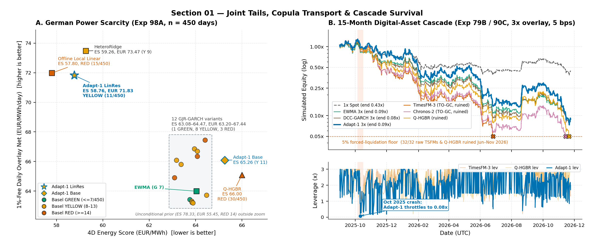
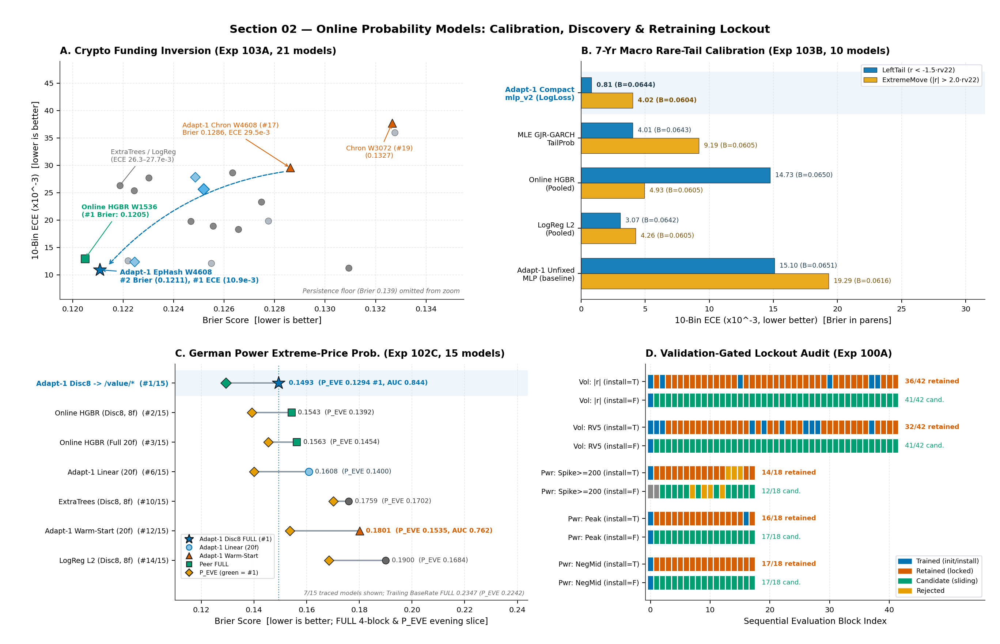
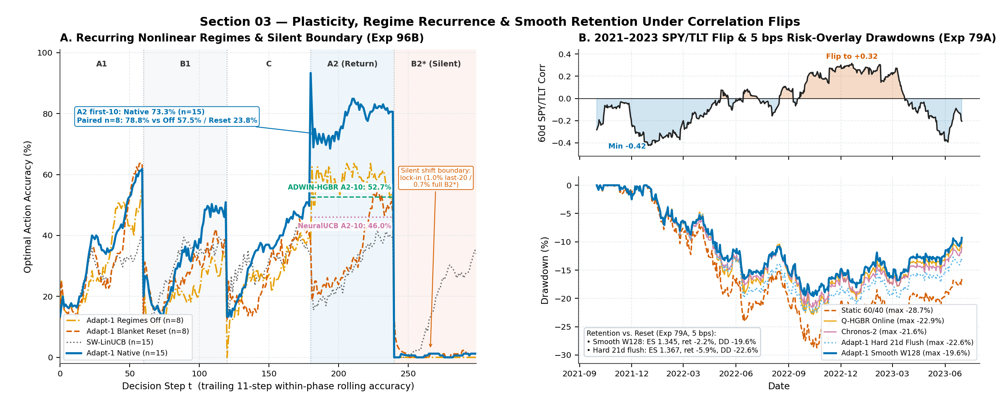
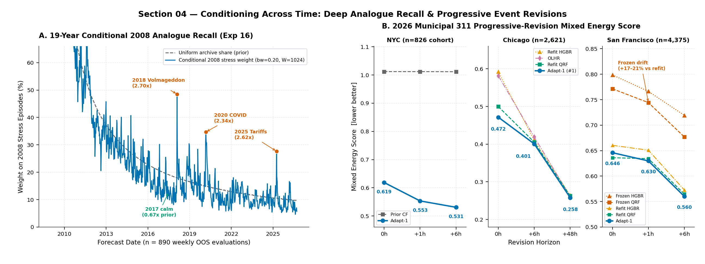
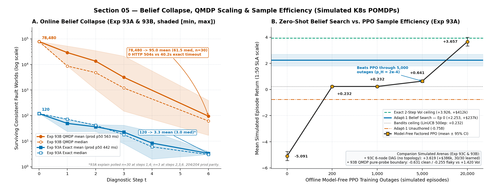
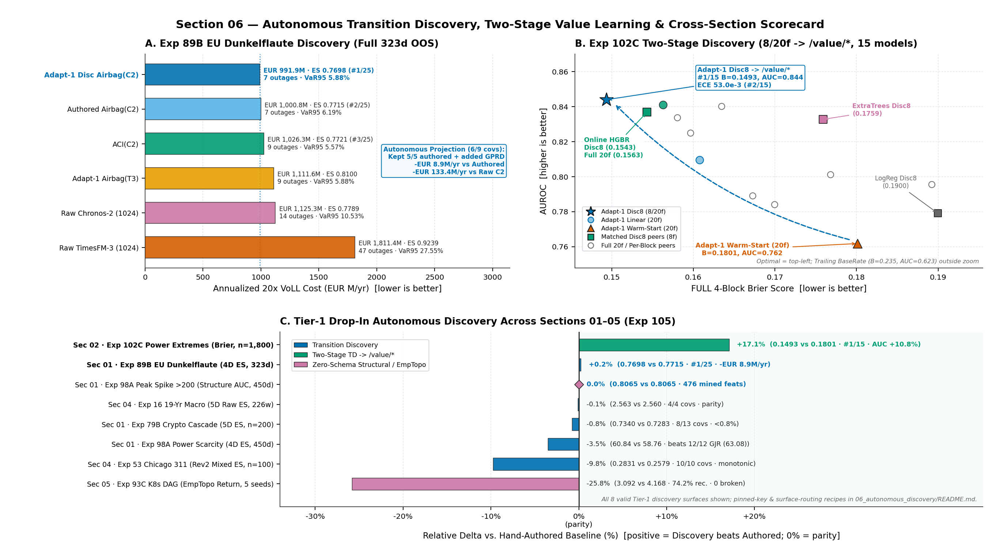

# Adapt-1 Research Series — Forecasting Replication Repository (`forecasting-series`)

> **Public audited traces, scorecards, and replication protocols for Rei Labs' Adapt-1 Forecasting Research Series.**
>
> **30-second offline verification (Python 3 standard library only, zero external packages):**
> ```bash
> python3 verify_traces.py
> ```

This repository packages the out-of-sample evaluation traces, audited scorecards, API configuration recipes, and zero-dependency integrity verifier supporting Rei Labs' **Adapt-1 Forecasting Research Series**. Every headline metric reported in the essay can be recomputed directly from the committed CSV traces, checked against cryptographic SHA-256 checksums, and audited for strict RFC-8259 validity and clean-room hygiene in seconds.

---

## Series Map

| Part | Title & Scope | Date | Directory | Status |
| :--- | :--- | :--- | :--- | :--- |
| **Part 1** | [*Forecasting From the First Outcome*](https://reilabs.org/blog/forecasting-from-the-first-outcome) — forecast receipts, prequential scoring, prior-vs-similarity, residual transport | Nov 2026 | `part-1-forecasting-`<br>`from-first-outcome/` *(reserved)* | Companion essay ([reilabs.org](https://reilabs.org/blog/forecasting-from-the-first-outcome)) |
| **Part 2** | ***Forecasting Through Drift*** — joint tails, online probability models, recurrence, multi-timescale conditioning, belief collapse | Nov 25, 2026 | [`part-2-forecasting-`<br>`through-drift/`](./part-2-forecasting-through-drift/) | **Published** (5 sections + Discovery) |

---

## Part 2: *Forecasting Through Drift* — Five Behaviors at a Glance

Adapt-1 is a unified online learning system exposing three typed surfaces—probabilistic joint `futures`, stateful `/value/*` & contextual `latent_belief` policies, and active `bound_transition` belief search. Each section directory under `part-2-forecasting-through-drift/` contains compact CSV traces, an audited `scorecard.json`, and a section-specific `README.md`.

| Section | Benchmark | Headline Result | Comparators & Config |
| :--- | :--- | :--- | :--- |
| **[01 — Joint tails](./part-2-forecasting-through-drift/01_joint_tails_and_drift/)**<br>`futures` (`linear_residual`) | `Exp 98A` SMARD DE power<br>`n=450` (`2025-08-27..2026-11-19`) | `ES_4D 58.76` EUR/MWh beats `12/12` GJR (`63.08`, `p_H=3.81e-4`), kernel (`65.26`, `p_H=2.10e-6`), Q-HGBR (`66.00`); `€71.83/MWh/d` (`YELLOW 11/450`) | Local lin-reg `57.80` (`€71.98`, `RED 15/450`); GJR `1 GREEN (6/450)`, `8 YELLOW`, `3 RED`; Q-HGBR `RED (30/450)`; `W<=128` cap |
| **01** (`futures` clouds) | `Exp 79B/90C` Binance 4-coin<br>`n=1,149` (3× `5 bps`) | `#1/12` `ES_5D 0.697`; `0.08×` Oct-25 throttle (`-28.4%` DD); survives at `0.09×` eq (1× spot `-56.5%` → `0.43×`) | `32/32` raw TSFMs (`8/8` `ctx=2,048`) & Q-HGBR ruined (`5%` floor, Jun–Nov 2026); EWMA/DCC (`0.08×`) survive `5 bps`; `15 bps` ruins levered |
| **01** (`futures` airbag) | `Exp 89B` EU 4-TSO wind (`n=323`, `ctx=1,024`) · `90A` / `98B` | Discovery `Airbag(C2)` **`#1/25`** (`ES 0.7698`, `€991.87M/yr`, `7` outages, `VaR95 5.88%` `p_cc=0.236` PASS) vs authored `#2/25` (`0.7715`, `€1,000.79M/yr`, `6.19%`); T3 `47→9` (`€1,811M→€1,112M`), C2 `14→7` (`€1,125.28M` raw) | Smooth `1,536d` US wind (`90A`) favors raw TSFMs (breaches `3→5`); FOMC/CPI (`98B`) favors GJR (`1.139` vs `1.145`) |
| **[02 — Online prob.](./part-2-forecasting-through-drift/02_online_probability_models/)**<br>`/value/*` (`mlp_v2`) | `Exp 103A` Binance funding<br>`n=16,077`, `256w`, `21` models | `episode_hash` + `warm_start=True` (`W=4,608`, `~2.3s`): `#2/21` Brier (`0.12108`), `#1/21` ECE (`0.01091`, `2.4×` < ET, `2.5×` < L2), `10W/0L` Holm (`24W/0L` slices), beats AR(1)-GJR (`0.12633`, `p_H=0.0049`), ties HGBR (`0.12049`, `p_H=1.00`), `#1/21` in 2026 | `chronological` drops to `#17/21` (`0.12862`) / `#19/21` (`0.13266`); post-Sep 2026 12w `#14/21` (`0.13721`, NS) |
| **02** (`/value/*` tails) | `Exp 103B` 8-asset macro<br>`n=13,856`, `360w`, `10` models (`W=4,096`, pre-2020 locked) | Compact `C3` `mlp_v2` (`16×8`, `45ep`, `log_loss`, `ws=False`): LT ECE `-94.7%` **`#1/10`** (`0.00081`), `#3/10` Br `0.06445`; EM ECE `-79.2%` (`0.00402`), **`#2/10`** Br `0.06045`, **`#1/10`** VIX-inv (`0.12048`), `2026` `#2/10` Br (`0.06808`) & `#1/10` ECE (`0.00619`); `0/108` Holm losses | `LogReg` (`0.06421`) & `MLE GJR` (`0.06430`, `p_H=1.00`) edge LT Br; `ET` (`0.06038`) edges EM Br; compact cap trades LT AUC (`0.5871→0.5688`, EM flat `0.6266`) |
| **02** (`/value/*` + Disc8) | `Exp 102C` DE power (`n=1,800`, `65w`, `15` models) · `100A` | Two-stage `Disc8→mlp_v2` (`16×8`, `80ep`, `ws=False`) **`#1/15`** `0.14933` (`BSS 32.86%`) / LL `0.46342` / AUC `0.8440` / `#2/15` ECE `0.05297`, **`#1/15`** `P_EVE` `0.12937` (LL `0.40908`, ECE `0.04908`); `9/14` Holm Brier & LL wins (`2/3` matched `Disc8`), `0` losses | Beats `HGBR_Disc8` (`#2/15` `0.15431`) & full-20 `HGBR` (`#3/15` `0.15627`); `linear` `#6/15` (`0.16078`, `#3` `P_EVE` `0.14004`); warm-start `mlp_v2` `#12/15` (`0.18012`); `100A` `install=True` froze `32–36/42` vol & `12–17/18` power blocks |
| **[03 — Plasticity](./part-2-forecasting-through-drift/03_plasticity_and_recurrence/)**<br>`latent_belief` (`recurrence`) | `Exp 96B` synthetic `K=6`<br>`A1→B1→C→A2→B2*` (`300` steps, `n=15`+`8`) | `15/15` reactivate `A1` on `t=181`, beating `8/8` peers incl. ADWIN-HGBR (`52.7%`, `p_H=0.0016`) & NeuralUCB (`46.0%`, `p_H=0.0036`); `73.3%` first-10 / `78.7%` full `A2` (`65.0%` at 4-step delay); `n=8`: `78.8%` → `57.5%` off → `23.8%` resets | Linear/context-blind peers cap `<=29.3%`; silent `B2*` locks native at `1.0%` (blanket resets `1.2%`; failure-triggered resets cure lock-in at archive-wipe cost) |
| **03** (`futures` retention) | `Exp 79A` SPY/TLT flip<br>`n=439` (`2021–2023`, `5 bps`) | Smooth retention holds DD `-19.6%` (`ES 1.345`, `VaR99 PASS`, `p_cc=0.906`) vs Static 60/40 (`-28.7%`) | Hard 21d flush degrades ES (`1.345→1.367`, `p_H=0.0189`) and net return (`-2.25%→-5.95%`) |
| **[04 — Conditioning](./part-2-forecasting-through-drift/04_conditioning_across_time/)**<br>Deep archive (`W=512..1024`) | `Exp 16` 19-yr 5-asset macro<br>`2008–2026`, `n=890`, `1,024w` | At `bw=0.20, W=1024`, 2008 weight shifts `0.67×` (2017) / `0.47×` (late 2026) → `2.70×` (2018), `2.34×` (Mar 2020; `1.62×` 13w), `2.62×` (Apr 2025); `9/9` (`W>=128, bw>=0.20`) pass `3/3` FRTB & beat DCC-FHS (`2.3336`) (`5/9` sig; `W=512, bw=0.30` `2.3208`, `t=-3.78`) | DCC-FHS & EWMA-FHS pass `3/3` FRTB (Gaussian fails); `bw=0.10` fails 99% ES cal |
| **04** (`shared future_id`) | `Exp 53`+NYC 311 (`11,326` ckpts) · `54` Bugzilla · `59` SF EMS | NYC identical (`n=826`) ES `0.619→0.553→0.531` (`±0.5 pp` 7d overrun cal); Chicago `#1/7` all 3 stages (`-18.9%` vs OLHR at `0h`, `p_H<1e-4`); SF `#1/7` at `+1h/+6h` | SF `0h` `#2/7` (`0.6459` vs Refit QRF `0.6361`), frozen drift `+17%–24%`; logs must be append-only; `54/59` heavy tails favor QRF/trees |
| **[05 — Belief collapse](./part-2-forecasting-through-drift/05_belief_collapse/)**<br>`bound_transition` (exact) | `Exp 93A` (`120`w) & `93C` (6-node DAG) sim K8s · Eq. 1 | 1-cloud scoring cuts API calls `27×`; **93A:** `120→3.3` worlds in 6 steps (`+2.253`, `+$237k`) from ep 0, beats PPO through `5,000` eps (`+$67k`, `p_H=2e-4`); **93C:** topology-free factorized belief learns `30/30` (`+3.619`, `+$386k`) | Authored Exact VoI (`+3.926`, `+$412k`) & POMCP set ceiling; unauthored `-0.758`, bandits `<=+0.23`; PPO passes at `20,000` eps (`+3.657`, `+$384k`); `93C` ties PPO-1k, trails 5k/20k |
| **05** (`bound_transition` `qmdp`) | `Exp 93B` 3-axis 6-playbook<br>`78,480`w (`204/204` parity) | Collapses `78,480→95.0` mean (`61.5` med) worlds in `563 ms` p50 (`204/204` exact parity) where exact times out (`40 s`) | QMDP 1-step full-obs undervalues pure probes (`-0.631` clean / `-0.255` flaky vs `+1.420` VoI); `<900 ms` std / `~2s` deep-archive latency fits control planes |

---

## Diagnostic Figures (`figures/`)

All six figures below are rendered directly from the committed CSV traces and scorecards in `part-2-forecasting-through-drift/` (zero hardcoded curves). Regenerate them locally (requires `matplotlib` and `numpy`; `verify_traces.py` remains pure stdlib):

```bash
python3 scripts/plot_figures.py
```

### Section 01 — Joint Tails, Linear-Residual Transport & Crypto Cascade Survival

*Left: `Exp 98A` German power 4D Energy Score vs. 1%-fee daily overlay net (`EUR/MWh/day`) colored by Basel peak-breach zone across Adapt-1, all 12 GJR-GARCH variants, Q-HGBR, and Offline Local Linear Regression. Right: `Exp 79B/90C` 15-month simulated `3×` (`5 bps`) equity trajectories with the `5%` liquidation floor and dynamic leverage throttle (`0.08×` in Oct 2025).*

### Section 02 — Stateful Online Probability Models & Validation-Gated Lockouts

*Top-left (A): `Exp 103A` 5-year crypto funding sign-flips (`n=16,077`) Brier vs. ECE across all 21 models showing `Adapt-1 EpHash W=4,608` (`#2` Brier, `#1` ECE) vs. chronological split degradation (`#17/#19`). Top-right (B): `Exp 103B` 7-year macro rare-tail equal-window (`W=4,096`, `10` models/target) ECE and Brier comparing `Compact C3` (`#1/10` LT ECE `0.81e-3`, `#3/10` LT Brier `0.06445`; EM ECE `4.02e-3` [`-79.2%`], `#2/10` EM Brier `0.06045`) against `MLE GJR-GARCH`, `Online HGBR`, `LogReg L2`, and the unfixed MLP baseline. Bottom-left (C): `Exp 102C` `15`-model German power extremes showing `Adapt-1 Disc8 -> /value/*` (`#1/15` FULL `0.1493`, `#1/15` `P_EVE 0.1294`, AUROC `0.844`) over matched `Online HGBR (Disc8)` (`0.1543`) and full-20 `Online HGBR` (`0.1563`). Bottom-right (D): `Exp 100A` block-by-block validation-gated `install=True` retention lockout strip chart.*

### Section 03 — Plasticity, Latent Regime Recurrence & 2022 Stock-Bond Flip

*Left: `Exp 96B` 300-step rolling accuracy across `A1 | B1 | C | A2 (Return) | B2* (Silent)` comparing `n=15` Adapt-1 Native against `n=8` ablations (`Regimes Off`, `Blanket Reset`) and online peers (`ADWIN-HGBR`, `NeuralUCB`, `SW-LinUCB`). Right: `Exp 79A` 2021–2023 60-day SPY/TLT correlation flip and simulated `5 bps` drawdowns (`-19.6%` smooth retention vs. `-28.7%` Static 60/40 and hard 21-day flush degradation).*

### Section 04 — Conditioning Across Time: 19-Year Macro Archive & 311 Revisions

*Left: `Exp 16` 19-year weekly conditional 2008 GFC similarity weight (`bw=0.20, W=1,024`) vs. uniform baseline, highlighting `0.67×` calm (2017) and `2.34×–2.70×` stress recall (2018 Volmageddon, 2020 COVID, 2025 tariffs). Right: 2026 municipal 311 progressive-revision mixed Energy Score across NYC (`n=826` identical cohort), Chicago (`0h/+6h/+48h`), and San Francisco (`0h/+1h/+6h`, including frozen baseline drift).*

### Section 05 — Active Belief Collapse, PPO Learning Curve & 78,480-World QMDP Scaling

*Left: Log-scale surviving fault worlds by diagnostic step for simulated K8s triage in `Exp 93A` (`120 -> 3.3`) and `Exp 93B` (`78,480 -> 95.0` mean / `61.5` median in `563 ms` p50). Right: `Exp 93A` mean episode return across `0–20,000` offline PPO episodes vs. episode-zero Adapt-1 Belief Search (`+2.253`), Exact VoI (`+3.926`), topology-free `Exp 93C` DAG (`+3.619`), and the `Exp 93B` QMDP pure-probe boundary (`-0.631` vs. `+1.420`).*

### Section 06 — Autonomous Transition Discovery & Two-Stage Value Learning

*Top-left (A): `Exp 89B` full 323-day EU wind Dunkelflaute Transition Discovery `Airbag(Chronos-2)` (`#1/25` 4D ES `0.7698`, `€991.9M/yr`, `7` outages, `VaR95 5.88%`) vs. authored wrapping (`0.7715`, `€1,000.8M/yr`), `ACI(C2)`, `Airbag(T3)`, and raw TSFMs. Top-right (B): `Exp 102C` `15`-model FULL 4-block Brier vs. AUROC showing Two-Stage Discovery (`8/20` features) → `/value/*` `mlp_v2` (`#1/15` `0.1493` Brier, `0.844` AUROC, `#2/15` ECE `53.0e-3`) advancing over authored `Warm-Start (20f)` (`0.1801`) and matched `Disc8` peers (`Online HGBR Disc8` `0.1543`, `ExtraTrees Disc8`, `LogReg Disc8`). Bottom (C): `Exp 105` Tier-1 drop-in autonomous discovery relative performance across all 8 valid Section 01–05 production benchmarks.*

---

## Discovery Mode Viability ([`06_autonomous_discovery/`](./part-2-forecasting-through-drift/06_autonomous_discovery/))

Every forecasting regime in this series can be run either with **hand-authored compact features** (the canonical configurations in [`REPLICATION_GUIDE.md`](./REPLICATION_GUIDE.md)) or in **Adapt-1 Discovery Mode** (`learning.transition.input_paths: []` with `autonomous_projection.enabled: true`, `learning.structure.feature_paths: []` with `representation.enabled: true`, Two-Stage Discovery $\to$ `/value/*`, or `empirical_topology_inference: true`). Full cross-section audited results (`15` paired benchmarks across all five sections, `24/24` domains verified deleted `404`) live in [`part-2-forecasting-through-drift/06_autonomous_discovery/`](./part-2-forecasting-through-drift/06_autonomous_discovery/):

- **Drop-in Production Wins:** Transition Discovery matches or beats hand-authored `futures` on `5/6` empirical streams — **`60.84` EUR/MWh** on full `450d` German power (`Exp 98A`, beating all `12/12` GJR-GARCH variants at `63.08` and Authored Kernel at `65.26`), **beating hand-authored Chronos-2 residual wrapping on full `323d` EU Dunkelflaute (`Exp 89B`, `#1/25` ES `0.7698` vs `0.7715`, `€991.87M/yr` vs `€1,000.79M/yr`, `VaR95 5.88%` `p_cc=0.236`)** by autonomously discovering `GPRD`, dead-heat parity on 19-yr macro (`Exp 16`, `2.563` vs `2.560`), within `0.8%` on crypto cascades (`Exp 79B`), and strict monotonic tightening on Chicago 311 (`Exp 53`, `0.593 -> 0.368 -> 0.283`). As a Two-Stage pruner into `/value/*`, cutting `20 -> 8` features on `Exp 102C` Power Pool **slashed Brier `0.1801 -> 0.1493` (`#1/15`, beating matched `Online_HGBR_Disc8` `0.1543` and full-20 `Online_HGBR` `0.1563`) and lifted AUROC `0.7618 -> 0.8440` (`+0.0822`)**. Structure Discovery on `Exp 98A` mined `476` active `@lag[1..2]`/interaction features (`0.8065` AUROC on evening peak spikes, `4` solar-glut drift detections), and `empirical_topology_inference` on `Exp 93C` 6-node DAGs recovered **`74.2%` of full authored return (`+3.092` vs `+4.168`, `0.0` broken closes)** with empty catalog and objective model.
- **Configuration & Surface Routing:** Because `autonomous_projection` selects signals by marginal warmup predictability, **pin structural entity-IDs in pooled multi-asset panels (`Exp 103A`) and slow regime indicators before rare correlation flips (`Exp 79A`)** while letting Discovery prune noisy covariates. Note also that `autonomous_projection` operates on `learning.transition` (not `learning.context` / `latent_belief`, so `Exp 96B` uses explicit context coordinates), exact 120-world POMDPs (`Exp 93A`) use belief search, and imbalanced binary probability estimation belongs on `/value/*` rather than symbolic `structure` rules. See [`06_autonomous_discovery/README.md`](./part-2-forecasting-through-drift/06_autonomous_discovery/README.md) and [`REPLICATION_GUIDE.md`](./REPLICATION_GUIDE.md#4-per-section-adapt-1-api-configuration-recipes).

---

## Technical Reference (`docs/`)

For external reviewers auditing baseline fidelity, mathematical scoring formulas, and stylized overlay equations directly against the evaluation code:

| Document | Scope | Key Contents |
| :--- | :--- | :--- |
| **[`BASELINES_FORECASTING.md`](./docs/BASELINES_FORECASTING.md)** | Sections 01, 03 & 04 | 12 `GJR-DCC-GARCH(1,1)` MLE/QML variants; Ridge/HGBR/EWMA/DCC; `TimesFM-3.0` & `Chronos-2` (`ctx=256..2,048`) + `ACI`; `K=6` generator + 8 bandits (`ADWIN-HGBR`, `NeuralUCB`, `SW-LinUCB`); 19-yr macro & 311 survival peers (`Refit QRF`, `OLHR`, `HGBR`) |
| **[`BASELINES_VALUE_AND_BELIEF.md`](./docs/BASELINES_VALUE_AND_BELIEF.md)** | Sections 02 & 05 | Library, feature, window (`W=512..4,608`), regularization & `DEV_CAL` specs for `21` crypto (`103A`), `10` macro (`103B`), and `15` power (`102C`) models + `Exp 100A` lockouts; K8s POMDP/DAG math (`93A/B/C`), `SlotFactoredPPO` (`0..20k`), `Exact VoI`, `POMCP`, bandits, QMDP analysis |
| **[`METHODS_AND_METRICS.md`](./docs/METHODS_AND_METRICS.md)** | Scoring, Stats & Overlays | Continuous/mixed Energy Score, CRPS, Brier/Log-Loss/`ECE`/`AUROC`; block-clustered Newey-West HAC, Holm (`p_H`), exact sign-flip permutation; Basel MAR33 / Kupiec / Christoffersen / Acerbi-Székely `Z_2`; all four stylized causal overlays (`98A`, `79B/90C`, `89B`, `79A`) |

---

## Quickstart

### 1. Offline Verification (30 Seconds, Zero Dependencies)

Requires only Python 3.9+ (standard library only):

```bash
python3 verify_traces.py
```

`verify_traces.py` enforces five independent verification gates:
1. **Cryptographic Integrity:** Recomputes SHA-256 checksums for every file against [`SHA256SUMS.txt`](./SHA256SUMS.txt) and verifies [`MANIFEST.json`](./MANIFEST.json) parity.
2. **Strict RFC-8259 Syntax & PNG Assets:** Parses every `.json`, `.jsonl`, and `.csv` file rejecting `NaN`, `Infinity`, `-Infinity`, and malformed rows, and validates PNG magic headers and non-empty sizes across `figures/*.png`.
3. **Clean-Room Hygiene Audit:** Scans every text artifact (`README.md`, `REPLICATION_GUIDE.md`, `docs/*.md`, `scripts/*.py`, traces, and scorecards) for zero local paths, zero secrets/API tokens, zero internal hostnames, zero prohibited hardware claims, and zero raw internal engine dumps.
4. **Raw-Trace Metric Reconciliation:** Recomputes 224 audited headline metrics across all six sections directly from the committed CSV traces and asserts exact agreement within tight tolerances.
5. **Repository Size Hygiene:** Verifies every single file stays cleanly below GitHub's size limits (`< 25 MB`).

### 2. Live API Replication

To replay any section directly against the hosted Adapt-1 API, configure your credentials via environment variables (never hardcode keys in scripts or configs):

```bash
export ADAPT_API_BASE="https://rei-neuroadapt-api.reilabs.org/api/v1"
export ADAPT_API_KEY="<your-api-key>"

# Verify connectivity (read-only GET /domains)
python3 scripts/adapt1_client.py --check
```

See [`REPLICATION_GUIDE.md`](./REPLICATION_GUIDE.md) for full environment setup, public data download instructions, per-section JSON configuration payloads, statistical testing formulas, and operating guardrails.

---

## Provenance & Epistemic Separation

Every benchmark in this repository is explicitly tagged into one of three provenance tiers so raw real-world observations are never conflated with stylized simulations:

| Provenance Tier | Real vs. Modeled | Benchmarks in Part 2 |
| :--- | :--- | :--- |
| **1. Raw Public Telemetry** | Real observations scored causally; zero synthetic overlays | `98A` SMARD power (ES), `103A` Binance funding, `103B` 8-asset macro, `102C` power extremes, `16` 19-yr macro (ES & FRTB), `53`+NYC 311, `54` Bugzilla, `59` SF EMS |
| **2. Stylized Causal Overlays** | Real prices/returns mapped via pre-locked fee, leverage, battery, or reserve rules | `98A` 1%-fee BESS/hedge, `79B/90C` 3× 5 bps crypto (15 bps sweep), `89B` EU 4-TSO VoLL reserve, `79A` 5 bps SPY/TLT |
| **3. Controlled Testbeds** | Synthetic stochastic generators or simulated POMDPs isolating causal mechanisms | `96B` synthetic `K=6` nonlinear recurring regimes (`A1→B1→C→A2→B2*`), `93A/B/C` simulated K8s POMDP/QMDP & 6-node DAG |

---

## Repository Structure & Package Footprint

The complete replication package contains **57 files (~15.7 MB / 15.0 MiB total)**, with every individual trace and figure kept well below GitHub's file-size ceiling (largest file: `2.97 MB` / `2.84 MiB`).

```text
forecasting-series/
├── README.md                                  # Series overview, 5-behavior summary & diagnostic figures
├── REPLICATION_GUIDE.md                       # Step-by-step live & offline replication manual
├── verify_traces.py                           # Zero-dependency 5-gate verification suite
├── MANIFEST.json                              # Machine-readable file index & byte/hash inventory
├── SHA256SUMS.txt                             # Cryptographic checksums for all tracked files
├── .gitignore                                 # Local cache, secret, and raw download exclusions
├── docs/                                      # 3 files (0.13 MB) — mathematical specs & baseline audits
│   ├── BASELINES_FORECASTING.md               # Sections 01, 03, 04 exact comparator specifications
│   ├── BASELINES_VALUE_AND_BELIEF.md          # Sections 02, 05 exact comparator & POMDP specifications
│   └── METHODS_AND_METRICS.md                 # Scoring rules, HAC/Holm/FRTB tests & overlay equations
├── figures/                                   # 6 PNGs — trace-derived diagnostic figures
│   ├── fig01_joint_tails_and_drift.png
│   ├── fig02_online_probability_models.png
│   ├── fig03_plasticity_and_recurrence.png
│   ├── fig04_conditioning_across_time.png
│   ├── fig05_belief_collapse_and_qmdp.png
│   └── fig06_autonomous_discovery.png
├── scripts/
│   ├── adapt1_client.py                       # Zero-dependency stdlib Adapt-1 REST client
│   └── plot_figures.py                        # Matplotlib figure generator (reads CSVs)
└── part-2-forecasting-through-drift/
    ├── 01_joint_tails_and_drift/              # 6 files (0.76 MB) — Exp 98A, 79B/90C, 89B (+ 98B/90A)
    ├── 02_online_probability_models/          # 7 files (6.73 MB) — Exp 103A, 103B, 102C, 100A
    ├── 03_plasticity_and_recurrence/          # 6 files (1.75 MB) — Exp 96B, 79A
    ├── 04_conditioning_across_time/           # 8 files (2.23 MB) — Exp 16, Exp 53 + NYC 311 (+ 54/59)
    ├── 05_belief_collapse/                    # 10 files (1.10 MB) — Exp 93A, 93B + parity, 93C
    └── 06_autonomous_discovery/               # 3 files (0.02 MB) — Cross-section Discovery audit (Exp 105)
```

---

## References

1. Gneiting, T. & Raftery, A. E. "Strictly Proper Scoring Rules, Prediction, and Estimation." *JASA* 102(477), 359–378 (2007).
2. Das, A., Kong, W., Sen, R. & Zhou, Y. "A decoder-only foundation model for time-series forecasting." *ICML* (2024) (`google/timesfm-3.0-pytorch`).
3. Ansari, A. F. et al. "Chronos: Learning the Language of Time Series." *TMLR* (2024) (`amazon/chronos-2`).
4. Gibbs, I. & Candès, E. "Adaptive Conformal Inference Under Distribution Shift." *NeurIPS* (2021).
5. Engle, R. "Dynamic Conditional Correlation: A Simple Class of Multivariate GARCH Models." *JBES* 20(3), 339–350 (2002).
6. Glosten, L. R., Jagannathan, R. & Runkle, D. E. "On the Relation between the Expected Value and the Volatility of the Nominal Excess Return on Stocks." *Journal of Finance* 48(5), 1779–1801 (1993).
7. Acerbi, C. & Székely, B. "Back-testing Expected Shortfall." *Risk* (2014); BCBS, *Minimum capital requirements for market risk* (2019).
8. Christoffersen, P. F. "Evaluating Interval Forecasts." *International Economic Review* 39(4), 841–862 (1998); Kupiec, P. H. *Journal of Derivatives* (1995).

**Documentation & Access:** Explore Adapt-1 at [docs.reilabs.org](https://docs.reilabs.org).
