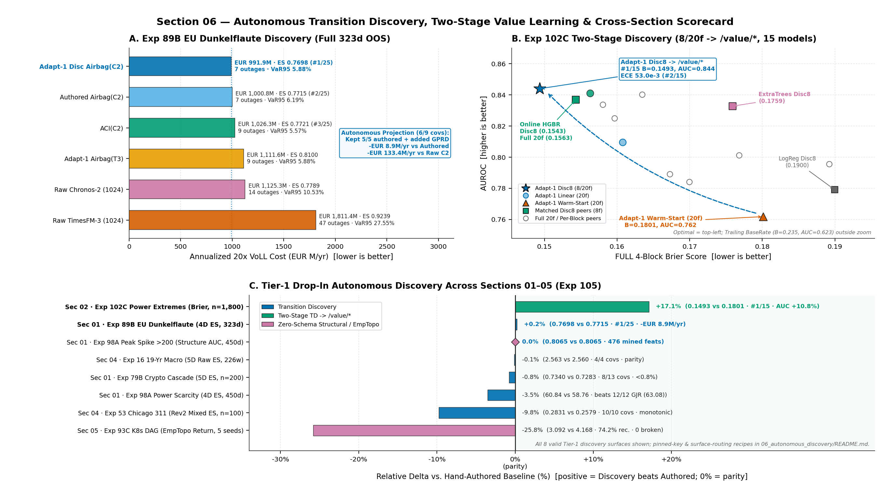

# Section 06 (Companion Audit) — Autonomous Discovery Across Sections 01–05

> **Question:** *How much hand-authored feature selection or domain ontology does Adapt-1 actually need across the five regimes in Part 2?*
>
> **Audit Summary:** Live evaluation of Adapt-1's official Discovery surfaces across all five Part 2 sections (`24/24` domains verified deleted `HTTP 404`, zero active domains post-flight, `100%` native API outputs). Every Discovery run is paired directly against the exact same out-of-sample rows, dates, or episode seeds from Sections `01`–`05`.

---

## Executive Decision Matrix — Three Engineering Tiers

Adapt-1 exposes three distinct Discovery mechanisms (`learning.transition.autonomous_projection`, `learning.structure.representation`, and `empirical_topology_inference` / zero-ontology `learning.sequential`). Grouping results by API surface gives a clear configuration guide:

### Tier 1 — Drop-in Production Wins (Zero Hand-Picked Features)

| Sec | Benchmark (Slice) | Surface | Discovery | Authored / Peers | Finding |
| :--- | :--- | :--- | ---: | ---: | :--- |
| **01** | **Exp 98A Power** (`n=450`) | Transition (11f, LinRes) | **60.84** EUR/MWh | LinRes 58.76 · GJR 63.08 · Kern 65.26 | Kept 6/8 + `p_std7`, `p_spread_prev` (0 churn); beats 12/12 GJR |
| **01** | **Exp 98A Power** (`n=450`) | Structure (`rep=true`) | **0.8065** AUC (92.4% cov) | Symbolic rules (`ev_peak_` `spike_200`) | Mined 476 `@lag[1..2]`/inter. feats, 601 lags, 73 inter., 4 drift alerts |
| **01** | **Exp 89B Dunkelflaute** (`323d`, C2) | Transition (9 covs) | **#1/25 0.76981** · €991.87M | 0.77152 · €1,000.79M | Kept 5/5 + **GPRD** (6/9); 7 out., VaR95 5.88% (`p_cc=0.236`); 150d 0.78694 vs 0.79077 |
| **01** | **Exp 79B Crypto** (`n=200`, Oct 25) | Transition (13f) | **0.7340** ES5D | 0.7283 (Ridge 0.7300) | Kept 8/13 incl. `basis_bps_raw`, `f_flow_state`, `f_ewma_vol` (within 0.8%) |
| **02** | **Exp 102C Power** (`n=1,800`) | 2-Stage `20→8` → `/value/*` | **#1/15 0.14933** · AUC 0.8440 | HGBR_D8 0.15431 · HGBR 0.15627 · MLP 0.18012 | `P_EVE 0.12937`; 4 block flags + lag1/7, `p_midday_prev`, `is_wknd_D`; 9/14 Holm wins, 0 losses |
| **04** | **Exp 16 Macro** (`n=250w`, raw) | Transition (4 covs) | **2.5632** ES5D | 2.5605 (`vix_term`) | Kept 4/4 (`log_vix`, `vix_term`, `corr_eq_y10_60d`, `oil_rv_22d`), parity (+0.11%) |
| **04** | **Exp 53 Chi 311** (`n=100`, post-09) | Transition (10 mixed) | **0.593 → 0.368 → 0.283** | 0.472 → 0.401 → 0.258 | Kept 10/10 intake + elapsed-age covs; strict monotonic tightening |
| **05** | **Exp 93C DAG** (`5` seeds) | `empirical_topology_` `inference` | **+3.092** (+$330k) | +4.168 (+$445k) · Seq +0.996 | Recovered **74.2%** of authored return (4.0/6 healthy, 0.0 broken closes) |

### Tier 2 — Best Practice: Pin Structural Keys, Discover Covariates

`autonomous_projection` selects signals by marginal predictive power over the warmup window. That makes it an effective high-dimensional covariate pruner (`102C`: `+0.082` AUROC), while two edge cases show why **structural keys** should remain pinned:

| Sec | Benchmark (Slice) | Discovery | Authored | Mechanism & Recipe |
| :--- | :--- | ---: | ---: | :--- |
| **02** | **Exp 103A Crypto** (`2026`, `n=2,928`) | Br 0.18520 · AUC 0.7444 | **Br 0.14814 · AUC 0.8453** | Pruned 19→8, dropped entity IDs (`is_btc/eth`, `own_f8`). **Recipe:** Pin entity IDs; discover market covs. |
| **03** | **Exp 79A SPY/TLT** (`200d`, 21–23) | 1.4199 ES4D | **1.3493 ES4D** | Kept 6/10 vol/DD; dropped `f_corr_sb` (flat pre-2022). **Recipe:** Pin slow regime indicators. |

### Surface Routing Notes

- **`learning.context` (`Exp 96B`):** `autonomous_projection` operates on `learning.transition`, not `latent_belief`; pass explicit `context.feature_paths` for contextual regime tracking.
- **`bound_transition` (`Exp 93A`):** Finite-world `120`-world POMDP belief collapse uses `bound_transition` belief search rather than unfactored `sequential` mode.
- **`/value/*` vs. symbolic `structure` (`Exp 102C` / `103A`):** `structure` + `representation` mines interpretable rules (`Exp 98A` `0.8065` AUC), while calibrated rare-event probabilities belong on `/value/*` (Tier 1 `#1/15`).

---

## Trace & Verification

- **Summary Trace:** [`exp105_discovery_benchmark_summary.csv`](./exp105_discovery_benchmark_summary.csv) (`15` audited rows across all 5 Part 2 sections)
- **Scorecard:** [`scorecard.json`](./scorecard.json)
- **Verification:** Reconciled directly by `python3 verify_traces.py` from the repository root (`Gate 4` Section `06` assertions).
